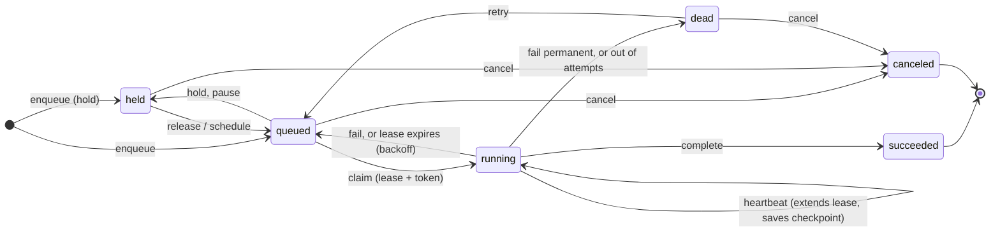

# laneq design

Why laneq is built the way it is: each decision, what it buys, what it costs,
and where it lives in the code. The [README](README.md) says what laneq does;
this says why.

- [1. Shape of the system](#1-shape-of-the-system)
- [2. Durability: the write-ahead log](#2-durability-the-write-ahead-log)
- [3. Group commit](#3-group-commit)
- [4. Snapshots and compaction](#4-snapshots-and-compaction)
- [5. Delivery: leases, heartbeats, fencing tokens](#5-delivery-leases-heartbeats-fencing-tokens)
- [6. Ordering: lanes](#6-ordering-lanes)
- [7. Failure handling: retries and dead jobs](#7-failure-handling-retries-and-dead-jobs)
- [8. Idempotency keys](#8-idempotency-keys)
- [9. Scheduling](#9-scheduling)
- [10. Finding work fast: indexes](#10-finding-work-fast-indexes)
- [11. Long-polling claims](#11-long-polling-claims)
- [12. HTTP API](#12-http-api)
- [13. Dashboard](#13-dashboard)
- [14. Worker supervision](#14-worker-supervision)
- [15. Testing strategy](#15-testing-strategy)
- [16. Performance history](#16-performance-history)
- [17. Known limitations](#17-known-limitations)
- [18. Questions to be ready for](#18-questions-to-be-ready-for)

---

## 1. Shape of the system

**Decision.** One process holds all queue state in memory behind a single
mutex. Every change is first recorded in a write-ahead log on disk. Workers talk
to it over HTTP/JSON. No database, no dependencies outside the Go standard
library.

**Why.**
- The workload it was built for (a few thousand jobs, a handful of workers on
  one machine) fits in memory many times over.
- A single mutex makes every operation trivially atomic: "claim the head of a
  lane" or "release three jobs and record that tonight ran" can't interleave
  with anything. Correctness is much easier to reason about than with
  fine-grained locks.
- HTTP/JSON means a worker can be written in any language. The production
  worker is Python because the media code already existed in Python.
- Owning the storage layer (instead of using SQLite or BoltDB) is the point of
  the project: the durability guarantees are built and tested here, not
  inherited.

**Alternatives.**
- *SQLite / Postgres with `SELECT … FOR UPDATE SKIP LOCKED`*: the practical
  production choice, and what to say you'd use at work. It hides exactly the
  parts this project is about.
- *Redis lists / streams*: fast, but durability depends on AOF fsync settings
  and the ordering/lease semantics have to be layered on top anyway.
- *Fine-grained locking (per lane)*: more parallelism, much harder to get right.
  Profiling (§16) showed the lock was never the bottleneck once fsync was off it.

**Cost.** Single node: no replication, no failover. State must fit in memory.
One lock serializes all in-memory work (fine at ~7k jobs/s, a ceiling beyond).

**Code.** `internal/queue/queue.go` (`Queue`, `Open`, `commit`).

---

## 2. Durability: the write-ahead log

**Decision.** Every change is appended to `wal.log` before it's acknowledged.
Each line is `<crc32 hex> <json>\n`, and each record holds the **full new state**
of one job, lane or schedule, not the operation that produced it.

**Why full state, not operations ("set job 7 to running", not "claim").**
Replaying is "last write wins": apply records in order, and the final value of
each object is its current state. Applying a record twice is harmless
(idempotent replay). That property is what makes the compaction crash window
safe (§4). Operation logs are smaller but replaying them twice corrupts state.

**Why a checksum on every line.** A crash mid-write leaves a *torn* record: a
partial line, or a full-length line containing garbage. On startup, the first
line that has no newline or fails its CRC32 marks the end of valid data; the
file is truncated there so new appends start on a clean line
(`openWAL`). Nothing after a torn line was ever acknowledged, because
acknowledgment waits for fsync, so dropping it loses nothing a client was told
about.

**Why JSON lines.** Human-readable (you can `tail` the log while debugging),
easy to replay, standard library only. Binary framing would be smaller and
faster to parse; at this scale that doesn't matter, and fsync dominates anyway.

**Why "fsync before acknowledging".** `write()` only reaches the OS page cache;
a power cut can lose it. `fsync` (`FlushFileBuffers` on Windows) returns only
once the data is on stable storage. The rule "a client is never told something
happened until it's on disk" is the whole durability guarantee, and the crash
test (§15) checks exactly that.

**Code.** `internal/queue/wal.go` (`openWAL`, `decodeLine`, `append`).

---

## 3. Group commit

**Decision.** Operations append records to an in-memory buffer while holding
the queue lock. After releasing the lock, each waits until a flush covers its
records. The first waiter to find no flush in flight becomes the **leader**: it
takes the whole buffer, writes it to the file, fsyncs, and wakes everyone it
covered. Everyone else waits on a `sync.Cond`.

**Why.** An fsync costs roughly the same whether it flushes 100 bytes or 100 KB.
Doing one per operation caps throughput at one operation per fsync. Batching
lets one fsync make many concurrent operations durable. This is the technique
PostgreSQL and MySQL use for their logs.

**Why the leader does the file write too (not just the fsync).** The first
version wrote to the file under the queue lock and only moved fsync out. The
profile showed `WriteFile` taking as long as `FlushFileBuffers`: **on Windows, a
write to a file blocks while a flush of that file is in progress**, so writers
holding the lock stalled behind every fsync anyway. Moving the write into the
leader, outside the lock, took throughput from 2,268 to 6,834 jobs/s.

**Why reads wait too.** `done()` waits for the log offset at the moment the
operation released the lock, even for read-only calls. Otherwise a reader could
see a change that's applied in memory but not yet on disk, act on it, and then
a crash erases it. Waiting means nothing observable is ever un-durable.

**Why ordering is preserved.** Records are appended to the buffer under the
queue lock, in the same order they're applied in memory, and the leader writes
the buffer in order. Log order equals apply order, so replay reproduces memory.
An acknowledged operation's offset is after everything it depended on, so
waiting for its own offset covers its dependencies too.

**Why failure is sticky.** If a write or fsync fails, the log can't be trusted:
a partial write leaves a torn line in the middle, and replay stops at the first
torn line, hiding everything after it. (PostgreSQL learned in 2018, "fsyncgate",
that retrying a failed fsync can silently lose data.) So after one failure the
WAL refuses all writes and the operator restarts.

**Cost.** Each operation's latency is now "wait for the current flush plus the
next one" in the worst case. Under light load that's one fsync, same as before.

**Code.** `wal.go` (`append`, `syncTo`), `queue.go` (`done`, `commit`).

---

## 4. Snapshots and compaction

**Decision.** Every 5,000 log records, the whole state is written to
`snapshot.json` (temp file → fsync → atomic rename) and the log is truncated.
Startup loads the snapshot, then replays the log.

**Why.** Without compaction the log grows forever and startup replays all of
history. Temp-file-then-rename makes the snapshot swap atomic: a crash leaves
either the old snapshot or the new one, never half of one.

**The race this has to avoid.** Truncating the log while a flush is in flight
would let that flush's old records land *after* the truncation, which on replay
would apply stale state on top of the newer snapshot and roll it back. So
`reset()` waits until no flush is running, drops the unflushed buffer (the
snapshot already contains those changes, since they were applied in memory
first), then truncates.

**The crash window.** If the process dies after the snapshot rename but before
the truncate, startup loads the new snapshot *and* replays the old log on top.
Because records are full-state and replay is last-write-wins (§2), that's
harmless: every replayed record is a state the snapshot already includes or
supersedes.

**Code.** `queue.go` (`snapshotLocked`), `wal.go` (`reset`, `writeSnapshot`).
Test: `TestGroupCommitSurvivesConstantCompaction` snapshots every 50 records
under 16 concurrent writers.

---

## 5. Delivery: leases, heartbeats, fencing tokens

**Decision.** A worker *claims* a job and gets a **lease** (default 60 s) and a
random **token**. It must heartbeat to extend the lease. If the lease runs out,
the job counts as a failed attempt and runs again. Complete/fail/heartbeat must
present the current token or get `409 lease lost`.

**Why at-least-once.** Exactly-once delivery is impossible when a worker can die
after doing the work but before reporting it: the queue can't tell "died before"
from "died after". So the queue guarantees at-least-once, and side effects are
made **idempotent** by the worker (the Instagram worker's duplicate check is the
real-world example).

**Why fencing tokens.** A worker can pause (GC, laptop sleep, network blip) past
its lease, the job gets re-leased to another worker, and then the first worker
wakes up and reports success for work it no longer owns. The token changes on
every claim, so the stale worker's report is rejected. Term from Martin
Kleppmann's writing on distributed locks.

**Why checkpoints ride on heartbeats.** A multi-step job (upload → process →
publish) saves progress with each heartbeat, so a retry resumes instead of
redoing expensive or non-repeatable steps. Making the checkpoint durable
*before* a side effect is what lets a retry know the side effect may have
happened.

**How expiry is detected.** Lazily on every operation (`expireLocked`), plus a
1-second ticker in `main.go` so expiries are recorded even when the queue is
idle. Expiry counts as an attempt, so a job that always crashes its worker
eventually goes dead instead of looping forever.

**Code.** `queue.go` (`claimLocked`, `Heartbeat`, `Complete`, `leased`,
`expireLocked`).

---

## 6. Ordering: lanes

**Decision.** Jobs with the same `lane` run one at a time in `Seq` order; only
the head of a lane can be claimed. Jobs with no lane are independent.

**Why.** The production use case (an Instagram grid) needs posts to go up in
date order, one at a time per account, while different accounts proceed in
parallel. Same idea as SQS FIFO message groups or Kafka partition keys.

**Why a dead job blocks its lane** (head-of-line blocking, on purpose). Skipping
a failed job would let later jobs overtake it and break the ordering guarantee.
An operator retries or cancels it to unblock the lane.

**Why `Seq` is separate from `ID`.** The ID identifies a job forever; `Seq` is
its position. Reordering (`Move`) swaps two jobs' `Seq` in one atomic commit
without renumbering anything else.

**Code.** `queue.go` (`lane`, `applyJob` keeps each lane's active list sorted by
`Seq`; `Move`).

---

## 7. Failure handling: retries and dead jobs

### What counts as a failure

A **failure** is any attempt at a job that doesn't end with the worker reporting
`complete` while it still holds the lease. laneq never sees *why* something went
wrong; it only sees one of three things:

| What laneq sees | Typical causes | What laneq does |
|---|---|---|
| **The worker reports it** (`POST /fail`) | The worker caught an error: no internet, an API refusing the request, a rate limit, a bad file | Retries after backoff, or after the worker's `retry_after`; goes straight to **dead** if the worker says `permanent` |
| **The worker goes silent**: no heartbeat for the lease period (60 s) | The worker crashed or was killed; the machine lost power or went to sleep; the worker hung | Treats it like a reported failure ("lease expired") and retries after backoff. The stale worker's token stops working (§5) |
| **laneq itself stops** | laneq crashed or was killed; power loss | On restart, replays the log (§2): anything acknowledged is still there. A job that was running still holds its lease; if the worker didn't survive, the lease expires and it's retried as above |

Every failed attempt counts toward `max_attempts`, whichever way it failed. A job
that keeps crashing its worker therefore ends up dead instead of looping
forever.

What a retry starts from is up to the worker: the job's checkpoint (§5) carries
whatever it saved before failing. For a step-by-step example of one worker's
failure modes, see the Instagram pipeline that runs on laneq (each step, what
can fail there, and what the retry does).

### Retries

**Decision.** A failed attempt is retried after `10s × 2^(attempt-1)`, capped at
1 hour, with ±20% jitter. After `max_attempts` (default 5) the job goes **dead**.
Workers can override with `retry_after` (e.g. a rate limit's reset time) or
`permanent` (retrying can't help: go straight to dead).

**Why exponential backoff.** Transient failures (a flaky network, a 5xx) usually
clear quickly; persistent ones shouldn't be hammered. **Why jitter:** without it,
many jobs that failed together retry together (thundering herd).

**Why dead isn't "finished".** A dead job still occupies its lane (§6) and shows
up in the dashboard's "Needs attention" until a person decides.

**Code.** `queue.go` (`failLocked`, `backoff`, `Retry`, `Cancel`).

---

## 8. Idempotency keys

**Decision.** `Enqueue` with a `key` that already exists returns the existing
job (HTTP 200 instead of 201) instead of creating a duplicate.

**Why.** Producers retry too: if an enqueue request times out, the producer
can't know whether it landed. With a key, retrying is safe. The backlog loader
uses `<member>:<post id>`, so re-running it after importing new photos adds only
the new posts. Keys are part of job state, so they survive restarts.

**Code.** `queue.go` (`Enqueue`, `byKey`).

---

## 9. Scheduling

**Decision.** A lane can have a daily schedule: "release N held jobs at HH:MM
local time, spaced G seconds apart." Jobs wait in a **held** state until
released; `Hold` undoes a release.

**Why held jobs instead of computing `run_at` up front.** The production backlog
is 1,700 posts. Pre-assigning dates would mean rewriting hundreds of jobs every
time one is skipped, reordered or the nightly count changes. With held jobs,
the queue order *is* the plan, and the schedule just takes the next N.

**Why `LastRun` stores the slot, not the wall-clock time it ran.** The question
each tick asks is "which slots between `LastRun` and now haven't run?" Storing
the slot (e.g. 00:00 Oct 23) makes that exact even if the run happened at 07:14
after the laptop woke up.

**Why catch-up exists, and why it's capped.** The machine may sleep through
midnight; on waking, missed nights run. A cap (`max_catch_up`, default 7) stops
a laptop that was off for a month from dumping a month of posts at once.

**Why the release and "tonight ran" are one log append.** If they were separate
writes, a crash between them would either lose the release or repeat it. One
append makes them atomic. Test:
`TestScheduleNeverReleasesTheSameNightTwiceAcrossRestart`.

**Why pausing is a full stop.** Pausing a scheduled lane must mean "nothing
more happens" to whoever presses it, with no loose ends. In one log append it:
- lets the running job finish (stopping it mid-way could leave a side effect
  half done);
- switches the schedule off, remembering whether it was on
  (`EnabledBeforePause`), and resuming restores exactly that, so a schedule
  that was off before the pause stays off after it;
- returns released-but-not-started jobs to held, at the front of the line.

While paused, `Release` is refused, `Retry` puts the job back to held instead
of queued, and saving the schedule updates the remembered setting rather than
switching it back on. Pausing twice changes nothing (it mustn't overwrite the
memory with "off"). On resume the paused days are marked as run, so they're
skipped rather than made up: resuming never causes a burst. `RunSchedules` also
skips paused lanes, as a second guard.

The first version only stopped claims while the schedule kept releasing, so a
week's pause meant a week of posts back to back on resume. The second switched
nothing off, so a `Retry` or `Release` during the pause could still leave
something to run on resume. Tests: `TestPauseIsAFullStop`,
`TestPauseSwitchesTheScheduleOffAndRestoresIt`, `TestPauseKeepsAnOffScheduleOff`,
`TestNothingCanBeReleasedOrRetriedIntoAPausedLane`, `TestPauseSurvivesRestart`.

**Other rules, each with a test:** a new schedule never fires immediately; a
schedule switched off and on again doesn't "catch up" the days it was off
(found while handling the Instagram block, see the pipeline notes); per-day
overrides ("only 1 tonight") are consumed once that day runs.

**Code.** `internal/queue/schedule.go`.

---

## 10. Finding work fast: indexes

**Decision.** Two indexes are maintained in `applyJob`:
- a **set of running jobs**, so lease expiry checks only leased jobs;
- a **min-heap of ready unordered jobs** keyed by `(RunAt, Seq)`, so a claim
  finds the next job in O(log n). Ordered lanes only need their head, so they're
  O(number of lanes).

**Why.** The profile showed every request scanning all 20,000 jobs (lease expiry
walked every active job; claiming an unordered job compared all of them).

**Why lazy deletion in the heap.** When a job is claimed, canceled or
rescheduled, its heap entry isn't removed (that would need an index into the
heap). Instead the entry records the job's `RunAt`/`Seq`, and when it surfaces
at the top, it's discarded if the job no longer matches (`fresh`). Common
technique, e.g. Dijkstra with a priority queue.

**Code.** `queue.go` (`readyHeap`, `nextUnordered`, `running`).

---

## 11. Long-polling claims

**Decision.** `POST /v1/claim` with `wait_seconds` blocks until a job is
runnable or the wait ends (max 60 s).

**Why.** Workers polling every second waste requests when idle and add up to a
second of latency when work arrives. Long-polling gives near-instant pickup with
almost no idle traffic.

**How waiters wake.** Every commit closes a `changed` channel and replaces it;
all blocked claims are selecting on it, so a close wakes them all (broadcast).
Each also sets a timer for the next moment something could become runnable
without a commit (a `run_at` arriving, a lease expiring).

**Code.** `queue.go` (`ClaimWait`, `claimOnce`, `commit`).

---

## 12. HTTP API

**Decision.** JSON over HTTP using Go 1.22+ method-and-path routing
(`"POST /v1/jobs/{id}/complete"`). Errors map to status codes: 404 not found,
409 lease lost / bad state, 400 invalid. Listens on `127.0.0.1` only, no auth.

**Why 409 for a lost lease.** It's a conflict with the current state, and the
worker needs to tell "my lease is gone, stop" apart from "the server broke,
retry".

**Why no auth.** Single-user, single-machine deployment bound to localhost.
Exposing it on a network would need auth first (stated in the README).

**Code.** `internal/api/api.go`.

---

## 13. Dashboard

**Decision.** One HTML file with plain JavaScript, embedded in the binary with
`go:embed`, polling the API every 5 seconds.

**Why.** No build step, no framework, nothing to install, ships inside the
binary. Polling is simple and plenty for a page one person watches.

**How it stays generic.** The engine knows nothing about Instagram. A producer
can put a `preview` object in a job's payload (title, caption, media URLs) and
mount a directory with `-files name=dir`; the dashboard shows thumbnails for
any job that has one. Jobs without a preview (like token refreshes) are
"background jobs", hidden behind a toggle.

**Code.** `internal/ui/index.html`.

---

## 14. Worker supervision

**Decision.** `laneq -- <command>` runs a worker as a child process, restarts it
with backoff if it exits (1 s doubling to 60 s, reset after a minute of uptime),
and on Windows puts it in a **job object** set to kill everything inside when
laneq's process ends.

**Why the job object.** Windows doesn't kill children when a parent dies. A
crashed or force-stopped laneq would leave its worker running, and the restarted
laneq would start a second one. (Lanes would keep that safe, but it's wasteful
and confusing.) With `JOB_OBJECT_LIMIT_KILL_ON_JOB_CLOSE`, the OS closes the job
handle when laneq exits however it exits, killing the worker and anything it
started (ffmpeg). Verified by force-killing laneq and checking the worker died.

**Why a shutdown endpoint.** Running without a console (so nothing flashes on
screen), laneq can't receive Ctrl+C, and Task Scheduler's "End" kills it
outright. `POST /v1/admin/shutdown` (loopback only) triggers the same path as
Ctrl+C: the supervisor stops the worker, the server stops accepting requests,
the queue writes a final snapshot, and the process logs "laneq stopped cleanly"
and exits 0. A test runs the real binary with a supervised child and checks
both processes exit and both ports are free afterwards.

**Code.** `cmd/laneq/supervise.go`, `cmd/laneq/hide_windows.go`, `cmd/laneq/main.go`.

---

## 15. Testing strategy

- **Fake clock** (`Options.Now`): lease expiry, backoff, schedules and
  multi-day catch-up are tested deterministically without sleeping.
- **Crash test** (`cmd/laneq/crash_test.go`): builds the real binary, runs 4
  producers and 4 workers against it, kills it with `TerminateProcess`/`SIGKILL`
  (no shutdown hooks) five times, then audits that every acknowledged enqueue
  and completion survived. It waits for real traffic before each kill, because
  CI disks fsync far more slowly than a laptop SSD.
- **Compaction under concurrency**: snapshots every 50 records while 16 writers
  run.
- **Torn and corrupt records**: hand-crafted partial lines and flipped bits.
- **Concurrency**: 8 workers × 200 jobs, checking no job is claimed twice.
- **CI**: Linux (with `-race`) and Windows, plus a benchmark smoke run.

## 16. Performance history

Each step came from a CPU profile (`laneq-bench -cpuprofile`), not a guess.

| Step | Jobs/s end to end | What the profile showed |
|---|---|---|
| fsync per write, under the lock | 1,011 | capped at one fsync per write |
| + group commit | 1,420 | more clients didn't help: something else serialized |
| + running set, ready heap | 2,268 | every request scanned all jobs |
| + buffered appends, leader writes outside the lock | **6,834** | Windows `WriteFile` blocked behind in-flight `FlushFileBuffers` |

Measured on an Intel Core Ultra 9 185H with an NVMe SSD. fsync speed dominates,
so numbers on other disks will differ.

## 17. Known limitations

- **Single node.** No replication; the disk is a single point of failure.
- **Memory-bound.** All jobs, including finished ones, stay in memory and in
  snapshots. Finished jobs are never deleted (a retention policy would be the
  next feature).
- **Lists are O(n).** `GET /v1/jobs` filters and sorts every job. Fine for a
  dashboard; would need indexes for large queues.
- **No auth**, localhost only.
- **At-least-once.** Exactly-once effects are the worker's job.
- **Job objects are Windows-only.** On Linux, use systemd or `Pdeathsig`.
- **Snapshots are whole-state.** Cost grows with total jobs; incremental
  checkpoints would scale further.

## 18. Questions to be ready for

1. *Why not just use Postgres?* (§1: at work you would; this project is about
   building the guarantees yourself.)
2. *What happens if the power goes out halfway through writing a log record?*
   (§2: CRC + newline detection, truncate at the first torn record; it was never
   acknowledged.)
3. *Why can't you guarantee exactly-once?* (§5: can't distinguish "died before"
   from "died after"; idempotent effects instead.)
4. *Walk me through group commit. Why did the first version only give 1.4×?*
   (§3, §16.)
5. *What's a fencing token and what bug does it prevent?* (§5.)
6. *What happens if the process crashes between writing the snapshot and
   truncating the log?* (§4: replay over the snapshot is harmless because
   records are full-state.)
7. *How would you make this distributed?* (Replicate the log with Raft, so a
   majority must have each record before it's acknowledged; leader handles
   claims; partition lanes across groups.)
8. *Why does a dead job block its lane?* (§6.)
9. *How did you find the bottlenecks?* (§16: CPU profiles; the Windows
   `WriteFile` finding.)
10. *What would you change with more time?* (§17: retention, incremental
    snapshots, auth, replication.)
