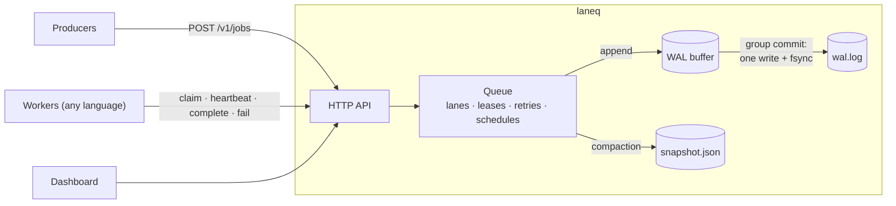

# laneq

A durable job queue in Go with ordered lanes, leases and retries, served over
HTTP/JSON so workers can be written in any language. Standard library only.

It runs an automated publishing pipeline in production: a Python worker posts a
1,700-post photo archive to Instagram on a nightly schedule, where a duplicate
or out-of-order post would be publicly visible.



## What it guarantees

- **Nothing acknowledged is lost.** Every change is appended to a checksummed
  write-ahead log and fsynced before the client hears back. On restart the
  queue replays the latest snapshot plus the log; a torn write from a crash
  fails its CRC32 and is discarded. A test kills the real server mid-traffic
  (no shutdown hooks) five times and checks every acknowledged enqueue and
  completion survived — ~20,000 per run.
- **At-least-once delivery.** A worker leases a job and heartbeats to keep it.
  If it dies, the lease expires and the job runs again; if the stale worker
  comes back, its result is rejected, because each lease carries a fencing
  token. Workers can save a checkpoint with each heartbeat so a retry resumes
  where the last attempt stopped.
- **Ordered lanes.** Jobs that share a lane run one at a time, in order. A job
  that runs out of attempts blocks its lane (it's never skipped), so later jobs
  can't overtake it. Jobs without a lane run in parallel.

## Features

- Retries with exponential backoff and jitter; `retry_after` for rate limits;
  `permanent` failures go straight to dead; retry/cancel/reorder for operators
- Idempotency keys: enqueueing the same key twice returns the original job
- Delayed jobs (`run_at`), held jobs released in batches, and daily schedules
  per lane ("release 3 at 00:00") that catch up on runs missed while the
  machine was asleep — without ever releasing the same day twice
- Pausing a lane is a full stop: the running job finishes, released jobs go back
  in line, and paused days are skipped rather than made up
- Long-polling claims and a built-in dashboard
- Optional worker supervision: `laneq -- python worker.py` restarts the worker
  if it crashes, and (on Windows, via a job object) never leaves it orphaned

## Performance

`go run ./cmd/laneq-bench` — over HTTP on localhost, every write fsynced before
it's acknowledged (Intel Core Ultra 9 185H, NVMe SSD, Windows 11):

| | end to end (enqueue → claim → complete) | enqueue only | p50 / p99 claim |
|---|---|---|---|
| 32 producers, 32 workers, unordered | **6,834 jobs/s** | 13,784 jobs/s | 1.0 ms / 8.0 ms |
| 16 producers, 16 workers, 100 lanes | **5,633 jobs/s** | 12,217 jobs/s | 1.0 ms / 4.3 ms |

How it got there, each step found with a profile:

| Change | End to end |
|---|---|
| Baseline: fsync per write, under the queue lock | 1,011 jobs/s |
| Group commit: one fsync covers every writer waiting on it | 1,420 jobs/s |
| Index running leases and ready jobs (heap) instead of scanning every job per request | 2,268 jobs/s |
| Buffer appends in memory; the commit leader does the file write and fsync outside the lock (on Windows, `WriteFile` blocks behind an in-flight `FlushFileBuffers`) | 6,834 jobs/s |

## Design notes

- **Group commit.** Operations append to an in-memory buffer while holding the
  queue lock, so log order is apply order. After releasing the lock, each one
  waits until a flush covers its offset: the first to find no flush in flight
  becomes the leader, writes the whole buffer and fsyncs, and wakes everyone it
  covered. Reads wait the same way, so a client never sees state that isn't
  durable yet.
- **Compaction.** After 5,000 log records the queue writes a snapshot (temp
  file, fsync, atomic rename) and truncates the log. Truncation waits for any
  in-flight flush; otherwise records flushed after it would land after the
  snapshot and roll state back on replay. Log records hold full object state,
  so replaying one twice is harmless.
- **Failure is sticky.** After a failed write or fsync the log can't be trusted
  (a torn line in the middle would hide everything after it from replay), so
  the queue refuses further writes rather than continue on a broken log.

## Running it

```sh
go run ./cmd/laneq -data ./laneq-data          # → http://127.0.0.1:7070 (dashboard + API)
go run ./cmd/laneq -data ./laneq-data -- python worker.py   # with a supervised worker
go test ./...                                   # includes the kill-and-restart test
go run ./cmd/laneq-bench -jobs 50000 -producers 32 -workers 32
```

The API listens on localhost by default and has no authentication.

Why it is built this way, decision by decision: [DESIGN.md](DESIGN.md).

## HTTP API

| | |
|---|---|
| `POST /v1/jobs` | enqueue `{type, lane, key, payload, run_at, hold, max_attempts}` |
| `GET /v1/jobs?lane=&state=&type=&newest=&offset=&limit=` | list (total in `X-Total-Count`) |
| `GET /v1/jobs/{id}` | one job |
| `POST /v1/claim` | lease a job `{worker, types, lease_seconds, wait_seconds}` → `{job, token}` or 204 |
| `POST /v1/jobs/{id}/heartbeat` | extend the lease, save a checkpoint `{token, checkpoint, lease_seconds}` |
| `POST /v1/jobs/{id}/complete` | `{token, result}` |
| `POST /v1/jobs/{id}/fail` | `{token, error, retry_after_seconds, permanent}` |
| `POST /v1/jobs/{id}/retry` · `/cancel` · `/move` | operator actions (`move`: `{delta: -1 or 1}`) |
| `GET /v1/lanes` · `POST /v1/lanes/{lane}/pause` · `/resume` · `/release` | lanes (`release`: `{n, run_at}`) |
| `GET /v1/schedules` · `PUT /v1/schedules/{lane}` · `POST /v1/schedules/{lane}/override` | daily releases |
| `POST /v1/admin/shutdown` | clean shutdown, from this machine only: stops the supervised worker, closes the port, writes a final snapshot, exits 0 |

A minimal worker:

```python
while True:
    lease = post("/v1/claim", {"worker": "w1", "types": ["resize"], "wait_seconds": 30})
    if not lease:
        continue
    try:
        result = handle(lease["job"]["payload"])
        post(f"/v1/jobs/{lease['job']['id']}/complete", {"token": lease["token"], "result": result})
    except Exception as e:
        post(f"/v1/jobs/{lease['job']['id']}/fail", {"token": lease["token"], "error": str(e)})
```
